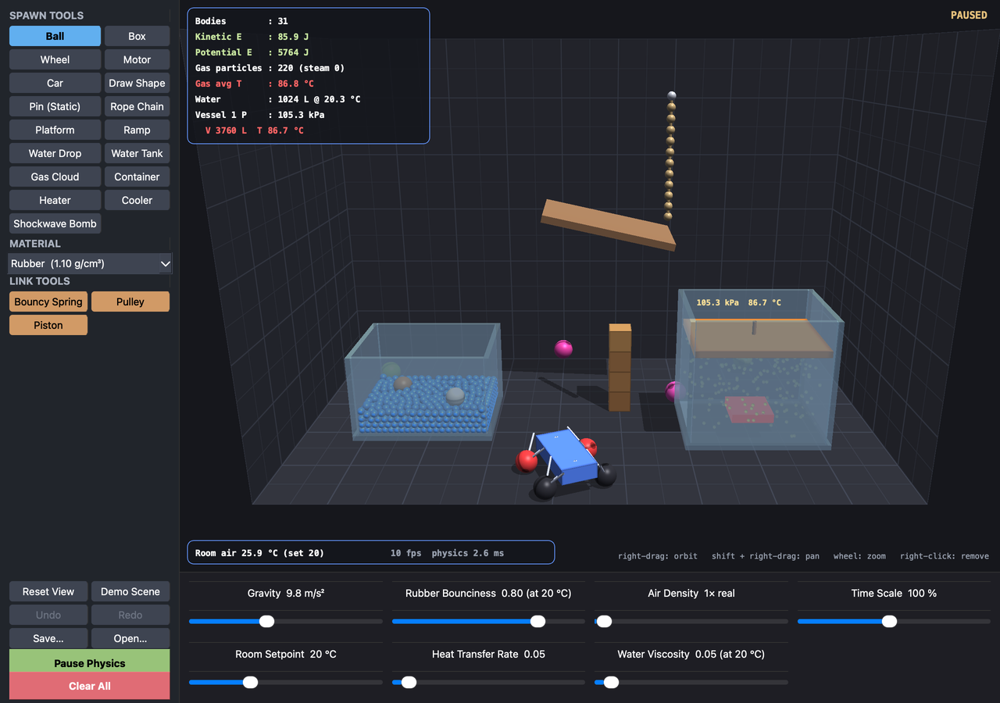

# Sapphire

A 3D physics and thermodynamics sandbox (Qt 6, OpenGL, C++17).



The room is 9 × 6 × 5 m. Everything in it is measured in real units: centimetres, kilograms, seconds, °C and kPa. Gravity is 9.8 m/s² by default, a litre of water weighs a kilogram, and a steel ball is 7.85 times heavier than the water it displaces.

## Build and run

```sh
cmake -S . -B build -DCMAKE_BUILD_TYPE=Release
cmake --build build -j
./build/sapphire
```

You need CMake 3.16 or newer and Qt 6 with the Widgets, OpenGL and OpenGLWidgets modules (`brew install qt` on macOS, `qt6-base-dev` on Debian/Ubuntu). The 3D view needs OpenGL 3.3. To build only the physics core and its tests (no Qt), pass `-DSAPPHIRE_BUILD_APP=OFF`.

`./build/sapphire --demo` opens straight into a scene that shows most features. `--screenshot file.png` runs that scene for a few seconds, saves a picture and quits.

## Tests

```sh
./build/sapphire_tests                                  # physics core, no Qt needed
./build/sapphire_tests buoyancy                         # only the tests whose name contains "buoyancy"
QT_QPA_PLATFORM=offscreen ./build/sapphire_ui_smoke     # drives the real window headlessly
ctest --test-dir build                                  # both
```

`sapphire_ui_smoke` needs the Qt Test module. If that module is missing, the target is skipped.

Many core tests compare the simulation with a textbook result:

| Test | Checks |
|---|---|
| free fall, bounce | A projectile follows its parabola. A steel ball (restitution 0.6) dropped from 2 m rebounds to 0.36 × 2 m. |
| rolling friction | A sliding solid sphere ends up rolling at 5/7 of its speed. |
| ramp friction | A wooden box (μ = 0.45) holds on a 15° ramp and slides ½ g (sin θ − μ cos θ) t² down a 35° one. |
| box stacking | Four stacked boxes stay stacked. A box dropped on a corner comes to rest on a face. |
| rope, pendulum | A pendulum swings with period 2π√(L/g). |
| air drag | A foam ball reaches terminal velocity √(2mg / ρ C_d A). |
| water, buoyancy | 1,536 L of water fills a 2 × 1.4 m tank to the depth its volume predicts. Wood floats 65 % submerged, foam rides high, steel sinks, a plank floats flat. |
| splash | A slab dropped flat onto the water splashes less than a metre high and the water stays in its tank. |
| ice | A frozen block bonds into a floe and floats mostly submerged. |
| vessel gas laws | Charles's law (V ∝ T at constant pressure). Fast compression lands between the isothermal and adiabatic limits and heats the gas. The gas carries a weight placed on the piston. |

## Layout

| Path | What it holds |
|---|---|
| `src/core/` | The simulation. Plain C++17 with no Qt, so it can be unit-tested. |
| `vector.h`, `random.h` | 3D vectors, quaternions, random numbers. |
| `material.h`, `thermo.h` | Materials (density, bounce, friction, heat capacity, conductivity) and the models for water and rubber: boiling point, density, viscosity, surface tension, restitution. |
| `physics_object.*` | One body: a rigid sphere or box, or a water, ice, steam or gas particle. Pose, inertia, temperature, phase and latent heat. |
| `collision.*` | Sphere and oriented-box contact tests, ray casts. |
| `constraints.*` | Springs, rigid links, pulleys, gas struts, wheel axles and rigid bead shapes. |
| `gas_container.h` | The sealed vessel with its piston. |
| `spatial_hash.*` | The broad phase (uniform 3D grid). |
| `world.*` | The step loop and the mechanical solver. |
| `fluid.cpp` | Liquid water. |
| `thermal.cpp` | Heat transfer, phase changes, vessels, gas, blasts. |
| `scene.cpp`, `serialization.cpp` | Spawning, picking and dragging; the scene file format, also used for undo. |
| `src/app/` | The Qt view: `renderer.*` draws the world with OpenGL, `camera.h` is the orbit camera, `physics_canvas.*` handles input, history and the fixed timestep, `main_window.*` holds the toolbox, sliders and shortcuts. |
| `tests/` | `core_tests.cpp` and `ui_smoke.cpp`. |
| `legacy/` | The last single-file 2D version, kept for reference. It is not built. |

## Controls

- **Left-click** empty space: spawn the selected object. It appears on the vertical plane through the middle of the view; the dashed plumb line and ring on the floor show how deep that is. Orbit or pan the camera to place things elsewhere.
- **Drag** an object to move it. Flick and release to throw it. While holding it, the **wheel** pushes it away or pulls it closer. Pins, platforms, heaters and coolers can be moved too.
- With a link tool (spring, pulley, piston), drag from one object to another.
- **Right-drag**: orbit the camera. **Shift + right-drag** or **middle-drag**: pan. **Wheel**: zoom. **Home**: reset the view.
- **Right-click** an object to remove it. Removing one wall removes the whole tank or vessel.
- **Draw Shape:** click to add points. Click the first point again, or right-click, to close the shape.
- **Material:** what new balls, boxes, wheels and shapes are made of (rubber, wood, steel, glass or foam).
- **Hover** over anything to see its material, temperature, phase, speed, mass, density, spin and bounce. Hovering a vessel shows the gas pressure and volume.
- Glass is click-through: click or hover inside a tank or vessel to reach what is in it.
- **Shortcuts:**
  - `Ctrl+Z` undo
  - `Ctrl+Shift+Z` or `Ctrl+Y` redo
  - `Ctrl+S` save
  - `Ctrl+O` open
  - `Space` pause

Scenes save as plain text (`*.sapphire`). The file stores the sliders' values as well. Scenes saved by the 2D version cannot be opened.

## How the simulation works

- **Fixed timestep.** `World::step()` always advances 1/60 s. The UI runs as many steps as real time (times the Time Scale slider) requires, up to 4 per tick. Results therefore don't depend on the display's frame rate.
- **Substepped position-based dynamics.** Based on Müller et al., 2020. Each frame runs 6 substeps, and each substep does this:
  1. Integrate forces into predicted positions and orientations.
  2. Solve links, contacts, the water's incompressibility and walls.
  3. Derive linear and angular velocities from the change in pose.
  4. Apply restitution, kinetic friction and rolling resistance in a velocity pass.
- **Rigid bodies.** Spheres and boxes have a full inertia tensor and a quaternion orientation. Boxes collide as oriented boxes (separating-axis test with face clipping), so they tumble, slide, stack and come to rest on a face. Static friction is solved at position level, which is why a box does not creep down a ramp it should hold on.
- **Materials.** Mass is density × volume. Friction, bounce, heat capacity and conductivity come from the material. Rubber's bounce follows the slider and its temperature.
- **Air.** Drag is ½ ρ C_d A v² with real air density (scaled by the slider), so foam falls visibly slower than steel.
- **Water.** Position Based Fluids (Macklin and Müller, 2013): each substep projects the constraint that the density may not exceed its rest value, which keeps the water incompressible. Viscosity follows the water's temperature, warm water rises through cold, and cohesion gives surface tension. Rigid bodies push water aside and feel Archimedes' force from the water level next to them, plus drag. A body that hits the water loses the momentum it gives to the water it shoves away. A box is weighed in eight blocks, which gives the torque that makes it float flat.
- **Ice.** Freezing water bonds into rigid floes. The buoyancy of a floe comes from its waterline, so ice floats mostly submerged.
- **Gas.** A Langevin thermostat sets each particle's speed from its temperature. Motion well above thermal speed, such as from a blast, is turned into heat. A vessel's pressure is N k T / V, and moving the piston heats or cools the gas adiabatically.
- **Heat.** Bodies conduct to what they touch, convect and radiate to the room in proportion to their surface, and the room air is itself a finite reservoir. Only the free surface of a pool evaporates.
- **Cars.** A rigid chassis rides on four ball wheels. Each wheel hangs on a tripod of damped struts and spins on an axle fixed in the chassis; the chassis feels the motors' reaction torque.
- **Drawn shapes.** The outline becomes a hoop of beads held rigid by shape matching (Müller et al., 2005).

## Known limitations

- Wheels are balls, not discs.
- A drawn shape is a hoop of beads: things smaller than the gaps between its beads can pass through it.
- Position-based dynamics damps a little. A pendulum loses about 1.5 % of its amplitude per swing, and a tall stack of boxes creeps by a few millimetres per minute.
- The surface of the water is only defined to within a particle (10 cm), so floating depths are right to a few centimetres. Water packs slightly denser against walls.
- A vessel's piston feels pressure as if its bore were about 7 % of its drawn area. With the true area, the atmosphere would outweigh anything you could put on it.
- Shadows fall on the floor only.
- Performance on a heavy test scene of about 2,200 bodies (1,536 of them water): roughly 6 ms per frame of physics on one core of an Apple-silicon Mac.
